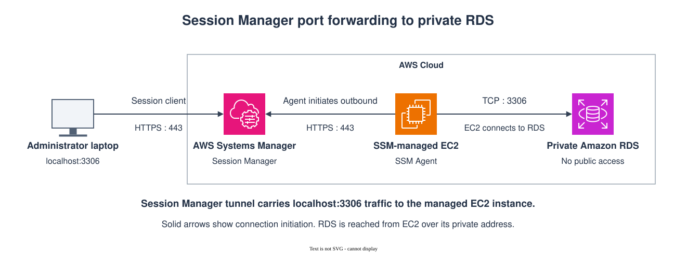

# Private RDS Administrative Access with AWS Systems Manager

A hands-on AWS architecture lab implementing secure administrative access to a private Amazon RDS database using AWS Systems Manager Session Manager.

The solution provides database access without exposing the managed EC2 instance or RDS to inbound administrative traffic and without requiring SSH, a bastion host, public IP addresses, or a NAT gateway for the managed-node Systems Manager path.

The environment was deployed with Terraform, validated end-to-end, subjected to controlled failure experiments, recovered, and destroyed after testing.

## Architecture

The implemented access path is:

**Administrator workstation → AWS Systems Manager → SSM-managed private EC2 → private Amazon RDS**



The EC2 instance acts as the managed network access point for the private database. Database administration uses the Systems Manager document `AWS-StartPortForwardingSessionToRemoteHost`, allowing a local database client to reach RDS through the managed EC2 instance.

### Network boundary

The private connectivity demonstrated by this lab applies specifically to the **managed-node side** of Systems Manager.

The EC2 instance reaches the required Systems Manager services through AWS PrivateLink interface VPC endpoints without requiring Internet or NAT connectivity.

The administrator workstation uses the normal AWS service/API path to initiate the Session Manager connection. Making the administrator-side path private through enterprise connectivity such as Direct Connect or VPN is outside the scope of this lab.

For the detailed Systems Manager network architecture, see the related deep dive:

**Private Access to AWS Systems Manager: Understanding the End-to-End Network Path**  
_Link will be added when the deep-dive page is published._

## Key design decisions

The implementation intentionally uses a small set of security and networking controls:

- EC2 runs in a private subnet with no public IP.
- EC2 has no inbound security-group rules.
- SSH is not used for administration.
- The SSM Agent uses an IAM instance profile with `AmazonSSMManagedInstanceCore`.
- Interface VPC endpoints provide private access to `ssm` and `ssmmessages`.
- Private DNS is enabled for both endpoints.
- The endpoint security group allows HTTPS only from the managed-node security group.
- RDS is private and encrypted.
- RDS accepts TCP 3306 only from the managed-node security group.
- EC2 outbound access is restricted to the required Systems Manager and database paths.
- IMDSv2 is required on EC2.
- The managed-node path has no NAT or Internet Gateway dependency.

The lab intentionally provisions `ssm` and `ssmmessages` endpoints rather than adding `ec2messages` without a demonstrated requirement.

Broader explanations of PrivateLink, Systems Manager service channels, DNS behavior, and enterprise hybrid connectivity belong in the associated architecture deep dives rather than being duplicated here.

## Remote database access

The repository includes a helper script that starts Systems Manager remote-host port forwarding:

```bash id="o7am8j"
./scripts/start-rds-tunnel.sh
```

The resulting connection is:

**Local MySQL client → localhost:13306 → Session Manager → managed EC2 → private RDS:3306**

A MySQL client can then connect through the local forwarded port:

```bash id="mqj65g"
mysql --protocol=TCP \
  -h 127.0.0.1 \
  -P 13306 \
  -u <database-user> \
  -p
```

The administrator workstation does not require direct network reachability to the RDS subnet.

During validation, MySQL identified the client using the managed EC2 private address. This confirmed that the managed node establishes the downstream database connection to RDS.

## What was validated

The deployed environment was tested at infrastructure, network, Systems Manager, and application levels.

Validation confirmed:

- EC2 had no public IP or inbound security-group rules.
- The private subnet had no Internet/NAT default route.
- RDS was not publicly accessible.
- `ssm.<region>.amazonaws.com` resolved to the SSM interface endpoint private address.
- `ssmmessages.<region>.amazonaws.com` resolved to its private endpoint address.
- the managed instance reported `Online` in Systems Manager.
- EC2 could reach the private RDS endpoint on TCP 3306.
- Session Manager remote-host forwarding established successfully.
- MySQL authentication through the tunnel succeeded.
- RDS observed the managed EC2 node as the source of the database connection.

The reproducible validation procedure is maintained in [`docs/validation.md`](docs/validation.md).

## Controlled failure experiments

After establishing the healthy baseline, four controlled failures were introduced.

| Experiment | Observed behavior | Boundary isolated |
|---|---|---|
| Block RDS TCP 3306 | SSM remained healthy; MySQL failed | EC2 → RDS |
| Block endpoint TCP 443 | New sessions returned `TargetNotConnected` | EC2 → Systems Manager |
| Disable Private DNS on the `ssm` endpoint | `ssm` resolved publicly while `ssmmessages` remained private; a fresh shell still worked | DNS / SSM service interaction |
| Stop the SSM Agent | New sessions returned `TargetNotConnected` | Managed-node agent |

The full procedures, observations, and recovery steps are maintained in [`docs/failure-experiments.md`](docs/failure-experiments.md).

## Key findings

The lab produced several useful architectural observations.

**A healthy Session Manager tunnel does not prove RDS connectivity.**  
The SSM path and the downstream EC2-to-RDS path can fail independently.

**`TargetNotConnected` identifies a symptom, not a single root cause.**  
The lab reproduced it both by disrupting endpoint connectivity and by stopping the SSM Agent.

**Private DNS and PrivateLink are related but distinct concerns.**  
Disabling Private DNS on the `ssm` endpoint changed the normal regional hostname from private endpoint resolution to public AWS resolution. Under the tested conditions, a fresh Session Manager shell still succeeded while the `ssmmessages` path remained private.

This is recorded as an observed result rather than generalized into a claim that the `ssm` endpoint is unnecessary.

**The managed EC2 instance establishes the downstream database connection.**  
MySQL reported the managed node's private address as the client source rather than the administrator workstation.

**SSM-only administration introduces a recovery consideration.**  
When the SSM Agent was deliberately stopped, Session Manager could not be used to restart the same agent. A production implementation should therefore define an appropriate recovery or break-glass mechanism.

## Terraform and failure injection

Terraform represents the healthy desired state of the lab. Controlled failures are introduced through temporary, reversible AWS-side changes rather than targeted Terraform destruction.
An earlier experiment demonstrated why this matters: an explicit Terraform dependency caused an EC2 replacement when a security-group rule was removed through targeted destruction.
See [`docs/failure-experiments.md`](docs/failure-experiments.md#terraform-lifecycle-lesson) for the observed behavior and the resulting testing approach.

## Repository structure

```text id="gpn89o"
.
├── README.md
├── architecture/
│   └── ssm-port-forwarding-private-rds.svg
├── docs/
│   ├── deployment.md
│   ├── validation.md
│   ├── failure-experiments.md
│   └── troubleshooting.md
├── scripts/
│   ├── common.sh
│   ├── start-rds-tunnel.sh
│   ├── start-shell.sh
│   └── validate.sh
├── terraform/
│   ├── .terraform.lock.hcl
│   ├── ec2.tf
│   ├── endpoints.tf
│   ├── flow-logs.tf
│   ├── iam.tf
│   ├── networking.tf
│   ├── outputs.tf
│   ├── providers.tf
│   ├── rds.tf
│   ├── security-groups.tf
│   ├── terraform.tfvars.example
│   ├── variables.tf
│   └── versions.tf
├── .gitignore
└── LICENSE
```

Terraform state, saved plans, local variable files, raw evidence, and other environment-specific runtime artifacts are intentionally excluded from source control.

## Deploy and test

Complete deployment instructions are available in [`docs/deployment.md`](docs/deployment.md).

After deployment, validate the environment using:

```bash id="n5j5tp"
./scripts/validate.sh
```

Then start the RDS forwarding session:

```bash id="n8yjz6"
./scripts/start-rds-tunnel.sh
```

See:

- [`docs/validation.md`](docs/validation.md) for healthy-state validation
- [`docs/failure-experiments.md`](docs/failure-experiments.md) for controlled failure testing
- [`docs/troubleshooting.md`](docs/troubleshooting.md) for operational diagnosis

## Cleanup

When testing is complete:

```bash id="oqp2zo"
terraform -chdir=terraform destroy
```

The tested environment successfully destroyed all 21 Terraform-managed resources.

A subsequent Terraform plan proposed recreating all 21 resources, confirming that the deployed infrastructure had been removed while the Terraform configuration remained reproducible.

## Related architecture content

This repository is intentionally focused on implementation and evidence rather than repeating the complete architectural theory behind AWS Systems Manager.

Related architecture content:

- **Private Access to AWS Systems Manager: Understanding the End-to-End Network Path** — networking, PrivateLink, Private DNS, and administrator versus managed-node paths
- **Securing and Auditing AWS Systems Manager Session Manager Access** — identity, authorization, session controls, logging, and audit architecture

Links will be added as the corresponding architecture pages are published.